<div align="center">



<br>

[](https://github.com/ArizoOwner/Arizo_Movie/actions)
[](https://github.com/ArizoOwner/Arizo_Movie/releases/latest)
[](LICENSE)
[](https://workers.cloudflare.com/)
[](https://core.telegram.org/bots/api)

[**English**](README.md) &nbsp;·&nbsp; [**فارسی**](README.fa.md)

<br>

<a href="https://arizo-owner.arizomovie.workers.dev/">
  
</a>

<sub>https://arizo-owner.arizomovie.workers.dev/</sub>

</div>


<div dir="rtl">

## این پروژه چیست؟

**Arizo Movie** یک ربات تلگرام برای کانال‌های فیلم و سریال است. نام فیلم را می‌نویسید، ربات مشخصات را از [TMDB](https://www.themoviedb.org/) می‌گیرد، پست را با هشتگ‌های فارسی ژانر می‌سازد، پوسترها را با دکمه‌های رنگی نشان می‌دهد و پست نهایی را در کانال شما منتشر می‌کند.

روی **Cloudflare Workers** و دیتابیس **D1** اجرا می‌شود، پس سروری برای اجاره کردن، به‌روز کردن یا زنده نگه داشتن ندارید. هر وقت کسی به ربات پیام بدهد، تلگرام از طریق وب‌هوک Worker شما را صدا می‌زند.


## امکانات

| | |
|---|---|
| 🎬 **جستجوی TMDB** | عنوان فارسی یا انگلیسی، فیلم یا سریال، سال و امتیاز |
| 🏷 **هشتگ فارسی** | ژانرهای TMDB تبدیل می‌شوند به `#اکشن`، `#علمی_تخیلی` و … |
| 📺 **فصل‌ها** | سریال چندفصلی با سال هر فصل فهرست می‌شود |
| 🖼 **گالری پوستر** | پوسترها را ورق بزنید، یکی را انتخاب کنید و کپشن نهایی را ببینید |
| 🔗 **اتصال فایل** | پیامی از کانال را فوروارد کنید یا لینکش را بفرستید |
| 🎨 **دکمه‌های رنگی** | دکمه‌های آبی، سبز و قرمز (Bot API نسخهٔ ۹٫۴ به بعد) |
| 🧙 **ویزارد راه‌اندازی** | توکن‌ها را بررسی می‌کند، دیتابیس می‌سازد و وب‌هوک را ثبت می‌کند |
| 🔄 **ترمیم وب‌هوک** | اگر تلگرام وب‌هوک را از دست بدهد، یک کرون دوباره آن را ثبت می‌کند |


## نصب در ۳ مرحله

> [!TIP]
> نیازی به ترمینال، `wrangler` یا حساب گیت‌هاب نیست.

### ۱ &nbsp; بگذارید ویزارد ربات را در Cloudflare **خودتان** بسازد

ویزارد همگانی را باز کنید: **https://arizo-owner.arizomovie.workers.dev/**

۱. روی **ساخت توکن Cloudflare** بزنید (دسترسی‌ها از قبل انتخاب شده‌اند) و توکن را بچسبانید.
۲. روی **نصب روی اکانت من** بزنید.
۳. یک آدرس Worker مخصوص خودتان و یک **کلید راه‌اندازی** یک‌بارمصرف می‌گیرید. هر دو را کپی کنید.

> [!IMPORTANT]
> **بدانید به چه کسی اعتماد می‌کنید.** در این مرحله توکن Cloudflare شما به Worker ویزارد همگانی فرستاده می‌شود. این Worker فقط برای همین نصب از آن استفاده می‌کند و ذخیره‌اش نمی‌کند (کد در [`worker.js`](worker.js) است، عبارت `handleInstallerApi` را جستجو کنید). شما نمی‌توانید تأیید کنید نسخهٔ در حال اجرا دقیقاً همین کد است؛ پس توکن را مخصوص همین کار بسازید و بعدش از داشبورد Cloudflare پاکش کنید. اگر نمی‌خواهید به کسی اعتماد کنید، از نصب دستی پایین استفاده کنید.

### ۲ &nbsp; ادامه روی Worker خودتان

آدرس جدید را باز کنید. ویزارد راه‌اندازی **خودش** بالا می‌آید و تا کامل شدن مراحل می‌ماند؛ تا آن موقع ربات به هیچ پیامی جواب نمی‌دهد.

۱. **کلید راه‌اندازی** مرحلهٔ قبل را وارد کنید.
۲. **توکن ربات** ([@BotFather](https://t.me/BotFather)) و **کلید TMDB** ([دریافت کلید](https://www.themoviedb.org/settings/api)) را وارد کنید. هرکدام با سرویس واقعی بررسی می‌شود.
۳. روی **نصب** بزنید.

### ۳ &nbsp; استفاده

ربات را ادمین کانال کنید (باید اجازهٔ ارسال پست داشته باشد)، `/start` را بفرستید و نام یک فیلم را بنویسید.

<details>
<summary><b>می‌خواهید دستی نصب کنید؟</b> (چسباندن فایل یا wrangler)</summary>

**چسباندن فایل.** فایل `worker.js` را از [آخرین ریلیز](https://github.com/ArizoOwner/Arizo_Movie/releases/latest) بگیرید. در داشبورد Cloudflare یک Worker بسازید، فایل را بچسبانید و دیپلوی کنید. آدرس Worker را باز کنید؛ ویزارد شروع می‌شود و با توکن Cloudflare دیتابیس را هم خودش می‌سازد و وصل می‌کند.

**wrangler.**
```bash
git clone https://github.com/ArizoOwner/Arizo_Movie.git
cd Arizo_Movie
npx wrangler login
npx wrangler deploy                 # دیتابیس D1 خودکار ساخته می‌شود
npx wrangler secret put SETUP_KEY   # هر متن تصادفی حداقل ۲۴ کاراکتری
```
بعد `/setup` را روی Worker باز کنید و با همان کلید وارد شوید.

**دیپلوی با هر push.** دو سکرت `CLOUDFLARE_API_TOKEN` (دسترسی Edit برای Workers و D1) و `CLOUDFLARE_ACCOUNT_ID` را در ریپو بگذارید. اگر هر دو نباشند، ورک‌فلو به‌جای خطا دادن، دیپلوی را رد می‌کند.

**ویزارد همگانی مخصوص خودتان.** با `npx wrangler deploy --var PUBLIC_INSTALLER:true` دیپلوی کنید. این متغیر را داخل `wrangler.toml` نگذارید، وگرنه هر نسخه از پروژه به غریبه‌ها پیشنهاد نصب می‌دهد.

</details>


## دستورات

| دستور | کار |
|---|---|
| `/start` | منوی اصلی و وضعیت کانال |
| `/setchannel` | انتخاب یا تغییر کانال مقصد (`@عمومی` یا لینک پست کانال خصوصی) |
| `/help` | راهنمای کوتاه |
| `/cancel` | لغو کار جاری |

## امنیت، بی‌پرده

- **هیچ چیز داخل کد نیست.** کلیدهای ربات و TMDB در دیتابیس D1 *خودتان* و از طریق ویزارد ذخیره می‌شوند.
- **به‌صورت متن ساده** ذخیره می‌شوند. هر کسی به اکانت Cloudflare شما دسترسی داشته باشد می‌تواند آن‌ها را بخواند. جزئیات در [PRIVACY.md](PRIVACY.md).
- **ویزارد قفل است.** هر درخواست تنظیمات باید با توکن Cloudflare همان اکانتی که Worker روی آن اجرا می‌شود یا با کلید راه‌اندازی ثابت کند صاحب است. اثبات غلط یا نبودنش رد می‌شود.
- **وب‌هوک تأیید می‌شود.** هر درخواست با یک رمز تصادفی بررسی می‌شود.
- **در دسترس بودن** به Cloudflare، تلگرام و TMDB بستگی دارد. پلن رایگان Cloudflare سقف درخواست روزانه دارد: [قیمت‌گذاری Workers](https://developers.cloudflare.com/workers/platform/pricing/).

جزئیات بیشتر در [SECURITY.md](SECURITY.md) و [DISCLAIMER.md](DISCLAIMER.md).

## نسخهٔ پایتون

فایل `app3.py` یک ربات polling است که روی کامپیوتر خودتان یا Docker اجرا می‌شود. `BOT_TOKEN` و `TMDB_KEY` را به‌صورت متغیر محیطی بگذارید، بعد `pip install -r requirements.txt` و `python app3.py`. نسخهٔ اصلی و نگهداری‌شده همان Worker بالاست.

## لایسنس

[MIT](LICENSE) © ArizoOwner

</div>


<div align="center"><sub>ساخته‌شده با 🎬 · <a href="README.md">English</a></sub></div>
