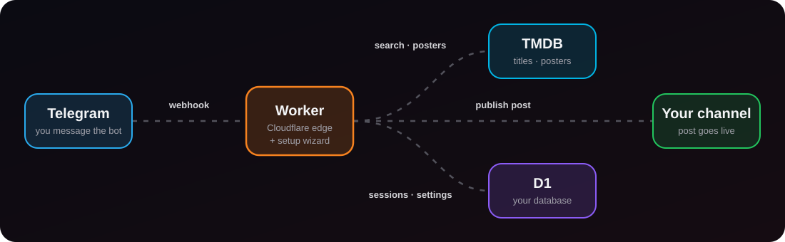

<div align="center">


<br>

[](https://github.com/ArizoOwner/Arizo_Movie/actions)
[](https://github.com/ArizoOwner/Arizo_Movie/releases/latest)
[](LICENSE)
[](https://workers.cloudflare.com/)
[](https://core.telegram.org/bots/api)

[**English**](README.md) &nbsp;·&nbsp; [**فارسی**](README.fa.md)

<br>

<a href="https://arizo-owner.arizomovie.workers.dev/">
  
</a>

<sub>https://arizo-owner.arizomovie.workers.dev/</sub>

</div>


## What is it?

**Arizo Movie** is a Telegram bot for movie and series channels. You type a title, it pulls the details from [TMDB](https://www.themoviedb.org/), builds the post with Persian genre hashtags, lets you flip through posters with coloured buttons, and publishes the finished post to your channel.

It runs on **Cloudflare Workers** with a **D1** database, so there is no server for you to rent, patch or keep alive. Telegram calls your Worker through a webhook whenever someone writes to the bot.



## Features

| | |
|---|---|
| 🎬 **TMDB search** | Persian or English titles, movie or series, year and rating |
| 🏷 **Persian hashtags** | TMDB genres become `#اکشن`, `#علمی_تخیلی`, … |
| 📺 **Seasons** | Multi-season shows list every season with its year |
| 🖼 **Poster gallery** | Flip through posters, pick one, see the final caption first |
| 🔗 **File linking** | Forward a message from your channel or paste its link |
| 🎨 **Coloured buttons** | Blue, green and red inline buttons (Bot API 9.4+) |
| 🧙 **Setup wizard** | Checks your tokens, creates the database, registers the webhook |
| 🔄 **Webhook self-heal** | A cron re-registers the webhook if Telegram loses it |
| ⬆️ **Updates from Telegram** | The owner presses a button, confirms, and the bot replaces its own file with the latest release (with rollback) |


## Install in 3 steps

> [!TIP]
> No terminal, no `wrangler`, no GitHub account needed.

### 1 &nbsp; Let the wizard put the bot in *your* Cloudflare

Open the public wizard: **https://arizo-owner.arizomovie.workers.dev/**

1. Press **Create Cloudflare token** (the permissions are pre-selected), then paste the token.
2. Press **Install on my account**.
3. You get your own Worker address and a one-time **setup key**. Copy both.

> [!IMPORTANT]
> **Know what you are trusting.** This step sends your Cloudflare token to the public wizard's Worker, which uses it for the install calls and does not store it (the code is in [`worker.js`](worker.js), search `handleInstallerApi`). You cannot verify that the running copy matches this source, so create the token just for this, and delete it in the Cloudflare dashboard afterwards. If you would rather not trust anyone, use the manual install below.

### 2 &nbsp; Finish on your own Worker

Open your new address. The setup wizard appears **by itself** and stays until setup is complete; until then the bot answers nothing.

1. Enter the **setup key** from step 1.
2. Enter your **bot token** ([@BotFather](https://t.me/BotFather)) and your **TMDB key** ([get one](https://www.themoviedb.org/settings/api)). Each is checked against the real service.
3. Press **Install**.

### 3 &nbsp; Become the owner and enable updates (optional)

On the last wizard screen, tick **Updates from inside Telegram** and open the **Become the owner** link once. After that only you see a **🔄 Check for updates** button in the bot's menu (or send `/update`).

- It looks at the latest GitHub release and compares the *content* of its file with yours, so it also notices a file that was **replaced on the same release** without a new tag.
- It never updates by itself. It shows what it found and waits for your **Update** tap.
- Your bot token, TMDB key, database, secrets and cron are kept. The previous version stays available and **↩️ Roll back** brings it back.
- The downloaded file is checked against its own embedded fingerprint first, so a truncated or edited download is refused.

> [!WARNING]
> To replace its own code the Worker needs your Cloudflare token, so it is stored as a secret on **your** Worker. That token can edit Workers and D1 databases in the accounts you picked when you created it, so pick **only the one account** and revoke it in the Cloudflare dashboard whenever you like. It is stored **only if you tick the box**; without it the bot still works and you update by re-pasting the new `worker.js`. Whoever owns your Telegram account (or your Cloudflare account) can update the bot.

### 4 &nbsp; Use it

Make the bot an admin of your channel (it must be allowed to post), send `/start`, and type a movie name.

<details>
<summary><b>Prefer to do it by hand?</b> (paste the file, or use wrangler)</summary>

**Paste the file.** Download `worker.js` from the [latest release](https://github.com/ArizoOwner/Arizo_Movie/releases/latest). In the Cloudflare dashboard create a Worker, paste the file, and deploy. Open the Worker address; the wizard starts and, with a Cloudflare token, creates and binds the database for you.

**wrangler.**
```bash
git clone https://github.com/ArizoOwner/Arizo_Movie.git
cd Arizo_Movie
npx wrangler login
npx wrangler deploy                 # D1 is created automatically
npx wrangler secret put SETUP_KEY   # any random string, at least 24 characters
```
Then open `/setup` on your Worker and sign in with that key.

**Deploy on every push.** Add the repository secrets `CLOUDFLARE_API_TOKEN` (Edit access for Workers and D1) and `CLOUDFLARE_ACCOUNT_ID`. Without both, the workflow skips the deploy instead of failing.

**Run your own public wizard.** Deploy with `npx wrangler deploy --var PUBLIC_INSTALLER:true`. Do not put that variable in `wrangler.toml`, or every copy of the project would offer to install itself for strangers.

</details>


## Commands

| Command | What it does |
|---|---|
| `/start` | Main menu and channel status |
| `/setchannel` | Choose or change the destination channel (`@public` or a private post link) |
| `/help` | Short guide |
| `/cancel` | Cancel the current action |

## Security, honestly

- **Nothing is hard-coded.** Bot and TMDB keys live in *your* D1 database, entered through the wizard.
- **They are stored as plain text** in that database. Anyone with access to your Cloudflare account can read them. See [PRIVACY.md](PRIVACY.md).
- **The wizard is locked.** Every setup call must prove ownership with a Cloudflare token for the account that runs the Worker, or with the setup key. Wrong or missing proof is refused.
- **The webhook is verified** with a random secret on every request.
- **Updates are opt-in and owner-only.** The Cloudflare token is stored only if you tick the box (see the warning above); the update button works only for the Telegram account that claimed ownership, in a private chat, and is re-checked on every tap.
- **Availability** depends on Cloudflare, Telegram and TMDB. Cloudflare's free plan has daily request limits: see [Workers pricing](https://developers.cloudflare.com/workers/platform/pricing/).

More in [SECURITY.md](SECURITY.md) and [DISCLAIMER.md](DISCLAIMER.md).

## Python version

`app3.py` is a polling bot for running on your own machine or in Docker. Set `BOT_TOKEN` and `TMDB_KEY` as environment variables, then `pip install -r requirements.txt` and `python app3.py`. The Worker above is the main, maintained version.

## License

[MIT](LICENSE) © ArizoOwner


<div align="center"><sub>Made with 🎬 · <a href="README.fa.md">فارسی</a></sub></div>
